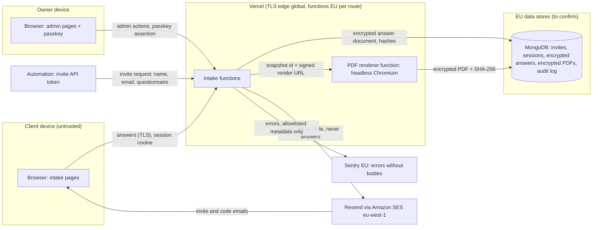

# Client intake system: design for review

**Status: review gate.** Nothing user-facing is built. Committed so far are the
versioned questionnaire definitions and schema (`app/lib/intake/`), the
generated field-level [data map](./data-map.md) and this document. Building
starts after the owner answers the [open questions](#10-open-questions).

The two Figma forms (`2000:451` Client intake & brand discovery, `2003:654`
Design systems intake & discovery, plus their Finnish versions `2012:842` and
`2012:1320`) define the content and the PDF output. Figma is the visual oracle;
the definitions in `app/lib/intake/questionnaires/` are the source.

## 1. What the system does

1. The owner, or an automation, invites a client to one questionnaire in one
   language.
2. The client opens the invite link, proves access to the invited inbox with a
   one-time code and gets a session.
3. The client fills the form in a site area built only from design-system
   components. Answers autosave; the client can leave and resume.
4. On submit the answers freeze into an immutable, hashed snapshot. A tagged
   PDF is rendered from that snapshot with the same components and archived.
5. The owner reviews, exports or deletes the submission in an admin area.
   Every admin action is audit logged.

## 2. Architecture and data flow

Trust boundaries: every arrow into `Intake functions` is untrusted input
validated with zod. Answers leave the functions only to MongoDB (encrypted),
the PDF renderer (same region, in memory) and the owner's admin view.

### Residency findings

| Component | Today | Needed for intake |
| --- | --- | --- |
| Vercel functions | Production deployments run in `iad1` (Washington DC). | Intake routes set `export const preferredRegion` to an EU region (`arn1` Stockholm or `fra1` Frankfurt). The rest of the site is unchanged. Vercel's edge still terminates TLS worldwide under Vercel's DPA. |
| MongoDB | Region not visible in the repo. | Must be an EU region. If the current cluster is not, intake gets its own EU cluster. **Open question.** |
| Email | Resend domain verified: DKIM at `resend._domainkey`, return path `send.digitaltableteur.com` through Amazon SES eu-west-1 (Ireland), DMARC `p=reject`. | Fine as is. Emails carry a name, a link or a code and an expiry, never answers. The contact route still falls back to `onboarding@resend.dev`; intake must send from the verified domain. |
| Sentry | EU region (`de.sentry.io`); request bodies off via the allowlist in `sentry.data-collection.ts`. | Fine as is. A canary test proves answer text never reaches Sentry. |
| Third-party scripts | The site loads Google Analytics, Ahrefs analytics and Cal.com; the production CSP allows `'unsafe-inline'` scripts. | **Largest existing-stack risk.** Intake pages use their own layout with no third-party scripts and a strict nonce-based CSP, so no analytics script can read answers from the page. |

## 3. Data map

The full per-field table is generated: [data-map.md](./data-map.md)
(`npm run generate:intake-data-map`, guarded by a test). In summary:

| Class | Brand discovery | Design systems | Examples |
| --- | --- | --- | --- |
| Personal | 8 | 6 | name, email, phone, role, time zone, typed acknowledgement |
| Third-party personal | 3 | 4 | decision-maker, collaborators, sponsor, access contacts |
| Business confidential | 48 | 52 | budgets, strategy, problems, systems, security constraints |
| Operational | 11 | 4 | service ticks, scales, confirmations, public website link |
| **Total answer fields** | **70** | **66** | |

Fields that need care beyond their class:

- **Pronouns** (`preferred_name`) can reveal gender identity. Optional, never
  shown in admin list views or emails.
- **Third-party names** (`decision_maker`, `collaborators`, `sponsor`,
  `approval`) are data about people who never saw the form. The privacy notice
  must cover them.
- **`sources`, `constraints_eng`, `ai_permissions`** may attract credentials or
  security detail. The help text already says not to share credentials; the
  server additionally flags likely secrets (token patterns) to the owner
  instead of storing them silently.

**At rest.** The whole answer document is encrypted with AES-256-GCM using a
per-document data key wrapped by a master key held outside the database
(`INTAKE_DATA_KEY`, with a key id for rotation). Only routing metadata stays in
clear: invite id, questionnaire id and version, status, timestamps, locale and
an HMAC of the email for lookup.

**Deletion.** Owner-triggered hard delete removes the invite, drafts,
submission and PDF and leaves a 12-month tombstone in the audit log (ids,
action, time, actor; no content). The existing public GDPR route deletes by
email without authentication, so it must not auto-delete intake records; for
intake it opens a deletion request the owner confirms.

## 4. STRIDE threat model

| ID | Threat | Mitigation | Verified by |
| --- | --- | --- | --- |
| S1 | Invite link forwarded or leaked | Link alone grants nothing: a one-time code to the invited inbox is required; link consumed on first successful login; 72 h expiry | e2e: reused link fails |
| S2 | Mail security scanners prefetch the link (Microsoft Safe Links) | GET never consumes anything; the token is redeemed only by a POST after a user action | e2e: GET twice, then login succeeds |
| S3 | Someone poses as the owner in admin | Admin requires a WebAuthn passkey registered by a CLI bootstrap; no email login for admin | e2e + ZAP: admin routes 401 without passkey session |
| S4 | Automation token stolen | Token scoped to `invite:create` only, stored hashed, rotatable, rate limited; cannot read answers | unit: token scope tests |
| T1 | Answers altered in transit or at rest | TLS; AES-GCM authentication tag; snapshot SHA-256 written to the audit log | unit: tampered ciphertext rejected |
| T2 | Edits after submission | Status machine; every write is conditional on `status: draft` | e2e: PATCH after submit returns 409 |
| T3 | Mass assignment, unknown fields, oversized input | Strict zod schemas (`app/lib/intake/schema.ts`), body limit 256 KB, field limits | unit tests (done) |
| R1 | Client disputes what was submitted | Snapshot and PDF hashes in the audit log; the PDF prints its hash and submission time | unit: hash is stable for canonical JSON |
| R2 | Admin action denied | Append-only audit log of invite, resend, revoke, expire, export and delete | e2e: each action writes one entry |
| I1 | Answers leak through logs or Sentry | No body logging; Sentry allowlist; intake errors carry ids only | canary string never found in Sentry or logs |
| I2 | Third-party scripts read the DOM | Dedicated layout without analytics; strict CSP on intake routes | Observatory and CSP header test |
| I3 | Probing whether an email has an invite | Identical responses and timing for known and unknown addresses | unit + e2e |
| I4 | PDF archive exposure | PDFs stored encrypted in MongoDB, served only through authenticated routes; no public blob URLs | ZAP + e2e |
| I5 | CDN or browser caches personal pages | `Cache-Control: no-store`, dynamic rendering | header test |
| I6 | Session theft through XSS | HttpOnly cookie, nonce CSP, components escape output | ZAP baseline, CSP test |
| D1 | Code flooding or email bombing | Per-invite and per-IP limits through `app/lib/rate-limit.ts` in fail-closed mode | unit + e2e |
| D2 | PDF rendering exhausts the function | Rendered once per submission, size caps, timeout, retry queue | load test of one render |
| E1 | A client reads another client's intake (IDOR) | Every query is scoped by the session's invite id; ids in URLs are opaque | e2e: cross-session access 404 |
| E2 | A client reaches admin routes | Separate cookie and session type; admin route guard | e2e |
| E3 | Brute-forcing the one-time code | 8 digits, 5 attempts per code, 10 per invite then lock | unit |

## 5. Access design

No password is ever generated or emailed. A password sent by email is a weak
point, and asking clients to type one adds friction for no security gain.

### Flows

1. **Invite.** Admin UI or automation creates an invite: questionnaire,
   locale, client name, email. The server creates a 256-bit random token,
   stores only its SHA-256 and emails the link with its expiry (72 h).
2. **Open.** `GET /intake/i/[token]` shows a page with one Continue button and
   consumes nothing. The POST behind it checks the token hash, status and
   expiry, sets a short-lived pre-auth cookie and emails an 8-digit code.
3. **Code.** The client enters the code (DS `TextInput`, `inputMode="numeric"`,
   `autocomplete="one-time-code"`). Codes live 10 minutes, are stored as HMACs
   and allow 5 attempts. Success consumes the invite token and creates a
   session: 256-bit id stored hashed, cookie `__Host-intake` with HttpOnly,
   Secure, SameSite=Strict, Path=/; 30 min idle, 12 h absolute; new id on
   every login.
4. **Return.** `/intake` asks for the email and always answers "If this
   address has an active intake, we have sent a code". Then step 3.
5. **End.** Logout, idle or absolute expiry, admin revoke and submission all
   end sessions server-side.
6. **Admin.** `/intake/admin` needs a passkey session under its own cookie
   `__Host-intake-admin`. The owner's passkey is registered once through a CLI
   bootstrap script; there is no admin sign-up.
7. **Automation.** `POST /api/intake/invites` with a bearer token stored
   hashed, scope `invite:create` only. This is the hook for the "something"
   that triggers a new intake (contact form, booking, Donny).

### OWASP ASVS 5.0 level 2

Requirement numbers in V6 are checked against the ASVS 5.0 source
(`5.0/en/0x15-V6-Authentication.md`). The full checklist lands in
`docs/intake/asvs-l2.md` during the build.

| Req. | Requirement | Design | Status |
| --- | --- | --- | --- |
| 6.3.3 (L2) | Multi-factor, or a combination of single-factor mechanisms | Link plus code both prove access to the same inbox: **one factor** | **Deviation, needs owner decision** |
| 6.3.6 (L3) | Email not used as an authentication mechanism | Email is the client factor | Not met; L3 is out of scope |
| 6.5.1 (L2) | Out-of-band codes usable once | Code and invite token are single use | Met |
| 6.5.2 (L2) | Low-entropy secrets stored hashed with salt | Codes stored as keyed HMACs; tokens are 256-bit and hashed | Met |
| 6.5.4 (L2) | Codes have at least 20 bits of entropy | 8 digits = 26.6 bits (6 digits would be 19.9 bits, a fail) | Met |
| 6.5.5 (L2) | Out-of-band codes expire quickly | 10 minutes | Met |
| 6.6.2 (L2) | Code bound to the original request | Code tied to the invite and the pre-auth cookie | Met |
| 6.6.3 (L2) | Brute-force protection for codes | Attempt limits plus rate limits | Met |

**The 6.3.3 deviation, stated plainly.** Anyone who controls the client's
inbox can open the intake. Options:

- **A. Accept** for clients. Access is invite-only, time-boxed and one
  respondent per invite, and the data is confidential business information,
  not regulated special-category data. Clients can add a passkey after first
  login, and admin must use one. Lowest friction.
- **B. Require a passkey** at first login. Meets 6.3.3, but some clients will
  stall on unfamiliar prompts and the 8-minute page-1 target gets harder.
- **C. SMS code** as a second channel. Restricted under 6.6.1 and needs a
  phone number most clients do not want to give.

Recommendation: **A**, with passkeys offered.

## 6. Lifecycle: draft, submit, PDF

- **Autosave.** Debounced PATCH (1.5 s, plus on blur and page change) with a
  revision number. The server validates with `draftSchema`, encrypts and bumps
  the revision; a stale revision (two tabs) returns 409 and a DS `Toast`
  offers a reload.
- **Submit.** `submissionSchema` checks required answers among visible
  fields, `pruneHiddenAnswers` drops answers to sections the client no longer
  sees, and the result becomes canonical JSON (sorted keys, NFC) with a
  SHA-256. The snapshot stores questionnaire id, version, locale, answers,
  submission time and hash. Drafts are deleted; the client keeps read-only
  access.
- **PDF.** The renderer opens an internal print route with a signed,
  short-lived URL and prints it with headless Chromium (`tagged` PDF,
  document language and title set). The page renders the DS components at web
  size on a 952 x 1347 px canvas and prints at `scale: 0.625`, which lands on
  the A4 print scale the Figma pages use. The PDF is hashed, encrypted and
  archived; the owner gets an email with a link, never the PDF.
- **Function size risk.** Chromium for Vercel (`@sparticuz/chromium`) is
  about 60 MB compressed, and this project has hit Vercel's 250 MB function
  limit before (routes bundling the repo through file tracing). The renderer
  gets its own route with strict tracing includes. Fallback: render in a small
  EU container triggered by a signed webhook. The first build spike measures
  the function size before anything else depends on it.

## 7. Design-system only, enforced

- **Lint rule.** `no-restricted-syntax` over `app/intake/**` and the PDF
  print route bans raw `input`, `textarea`, `select`, `button`, `label`,
  `fieldset`, `legend`, `h1` to `h6` and `p`. Layout uses DS layout
  components. `check:consumers` covers the rest.
- **Components that already exist:** TextInput, TextArea, Checkbox,
  CheckboxGroup, Radio, RadioGroup, Label, HelperText, GroupLabel, FormField,
  Title, Text, Divider, Button, AlertBanner, Toast, Progress, Pagination,
  Modal, DataTable, StatusDot, Badge, Timestamp, Logo.
- **Gaps to build first**, one component per tribunal trial, each with Figma
  parity:
  - **Scale**: the 1 to 5 brand character row, a horizontal RadioGroup with
    end labels and one accessible name.
  - **Form with error summary**: WCAG 3.3.1 wants errors listed and linked at
    the top on submit; no DS component does that today.
  - **Step navigation**: page list with completion state. Progress plus
    Pagination may be enough; decided in the tribunal.
  - **Print page shell**: header, footer and badge from the Intake Figma
    parts, as DS components instead of Figma-only parts.

## 8. Build or buy

**Buy.** Hosted form tools (Tally, Typeform, Jotform, Fillout) cost roughly
20 to 60 euros a month, handle conditional logic and partial saves, and
several offer EU hosting (verify each vendor's DPA). Collecting these answers
with one of them takes about a day.

**Build.** Roughly 11 to 15 focused days: DS gaps 2 to 3, access and admin 3
to 4, form and autosave 2 to 3, PDF pipeline 2 to 3, verification 2. Then
about half a day a month for dependency updates, key rotation and reviews.

**Why build is still right here:**

1. 100% design-system fidelity in both the web form and the PDF is impossible
   in hosted tools; their PDFs are vendor templates.
2. The system is itself a case study: a design system that drives a real
   product, Figma and code in parity, versioned contracts. That is what the
   site sells.
3. Data stays with processors already in the privacy notice (Vercel,
   MongoDB, Resend, Sentry) instead of adding a new one.
4. EN, FI and SV from one versioned schema, with old submissions always
   resolving against their own version.

If the only goal were collecting answers, buying would win.

## 9. Verification plan

| Done criterion | Tool | Note |
| --- | --- | --- |
| Full journey e2e | Playwright (in repo) | invite, code, draft, resume, submit, PDF |
| axe zero violations | `@axe-core/playwright` (in repo) | every intake page and state |
| VoiceOver pass | macOS VoiceOver, manual | scripted walkthrough recorded in the PR |
| PDF/UA | veraPDF CLI (Docker) | runs locally and in the gate |
| PAC | PAC 2024 | **Windows only**: needs a Windows machine or VM |
| Pixel diff vs Figma | `pixelmatch` (in repo) + Figma image export | threshold to agree, proposal below |
| ZAP baseline | `zaproxy/zap-stable` (Docker) | previews sit behind Vercel SSO protection, so scans need a bypass token or a local production build |
| ASVS L2 checklist | `docs/intake/asvs-l2.md` | with the 6.3.3 decision recorded |
| Observatory A | Mozilla HTTP Observatory | scan the intake URL; the site-wide CSP would not reach A |
| mail-tester 9+ | mail-tester.com, manual | invite and code emails |
| No answer text in Sentry | canary string test | submit a canary, search Sentry and logs |
| Local gate | typecheck, lint, test, build | exit 0 |
| Pilot | one real client | page 1 under 8 minutes |

Proposed pixel threshold: at most 1% differing pixels per page at 150 dpi,
pixelmatch threshold 0.1 with anti-aliasing ignored, compared with the Figma
page exported at the same size.

## 10. Open questions

The prompt's must-answer questions come first:

1. **Retention.** Accept invite 72 h, drafts 90 days after last edit,
   submissions 24 months and audit log 12 months
   (`app/lib/intake/data-policy.ts`)? Or shorter?
2. **After submit.** Admin area plus a notification email only, or also an
   export (JSON or CSV) into a CRM or Notion? The PDF is not emailed by
   default.
3. **Who triggers invites.** Owner only through admin, or also automation
   (contact form, booking, Donny)?

Then the ones the design depends on:

4. MongoDB Atlas region: EU?
5. ASVS 6.3.3: option A, B or C?
6. Owner admin login with a passkey on your devices: OK?
7. Client access after submit: read-only with PDF download, for how long?
8. Languages for v1: EN and FI (Figma exists) plus SV (copy drafted, needs a
   native review)?
9. Privacy notice: the actual text or URL to show at collection.
10. Pixel threshold: accept the proposal?
11. Vercel plan: confirm function size and duration limits for the PDF
    renderer, or approve the EU container fallback.
12. Is there a pilot client for the page-1 timing test?

## Appendix: what is committed now

- `app/lib/intake/types.ts`: definition types and data classes.
- `app/lib/intake/questionnaires/*.v1.ts`: both questionnaires, version
  1.0.0, EN, FI and SV copy, conditions and required fields. Generated once
  from the Figma inventory and owned by hand from now on.
- `app/lib/intake/schema.ts`: draft and submission zod schemas, visibility
  rules and pruning of hidden answers.
- `app/lib/intake/data-policy.ts`: retention and encryption proposal, data
  map renderer.
- Tests: Figma field coverage, copy completeness and house style, schema
  behaviour, conditions, data map in sync.

Decisions taken in the definitions, open to veto:

- **Required on submit**: the fields marked `*` on page 1, plus the "I have
  reviewed my answers" confirmation and the typed name. Everything else is
  optional.
- **The acknowledgement date** is stamped by the server, not typed.
- **Conditional content.**
  - The brand form shows the identity section for identity, redesign or
    "other" briefs, and the website section for digital, redesign or
    "other" briefs.
  - The design systems form shows the migration section for migration or
    unsure briefs, or when overlapping or mixed systems are reported. It
    shows the AI page for AI or unsure briefs.
  - With nothing ticked, everything shows.
