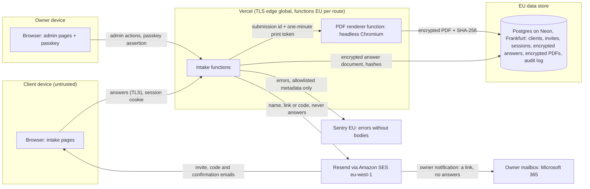

# Client intake system: design for review

**Status: decided 2026-10-26, building.** The owner's answers are recorded in
[section 10](#10-decisions-2026-10-26) and the build runs in the phases of
[section 11](#11-build-plan). Committed so far: the versioned questionnaire
definitions and schema (`app/lib/intake/`), the generated field-level
[data map](./data-map.md) and this document.

The two Figma forms (`2000:451` Client intake & brand discovery, `2003:654`
Design systems intake & discovery, plus their Finnish versions `2012:842` and
`2012:1320`) define the content and the PDF output. Figma is the visual oracle;
the definitions in `app/lib/intake/questionnaires/` are the source.

## 1. What the system does

1. The owner invites a client to one questionnaire in one language. Only the
   owner can create invites.
2. The client opens the invite link, proves access to the invited inbox with a
   one-time code and gets a session.
3. The client fills the form in a site area built only from design-system
   components. Answers autosave; the client can leave and resume.
4. On submit the answers freeze into an immutable, hashed snapshot, in the
   language the client was using on screen. A tagged PDF is rendered from that
   snapshot with the same components on its first download and archived.
5. The client's confirmation email links to the submission page, where they
   read their answers and download the PDF. The owner is notified by email
   with a link, never an attachment, and reviews, downloads or deletes the
   submission in the admin area. Every admin action is audit logged.

## 2. Architecture and data flow

Trust boundaries: every arrow into `Intake functions` is untrusted input
validated with zod. Answers leave the functions only to Postgres (encrypted),
the PDF renderer (same region, in memory), the client's own submission page
and the owner's admin view. No email carries answers or a PDF.

### Residency findings

| Component | Today | Needed for intake |
| --- | --- | --- |
| Vercel functions | Production deployments run in `iad1` (Washington DC). | Intake routes set `export const preferredRegion` to an EU region (`arn1` Stockholm or `fra1` Frankfurt). The rest of the site is unchanged. Vercel's edge still terminates TLS worldwide under Vercel's DPA. |
| Database | The site's MongoDB region is not visible in the repo. | Intake uses its own Postgres database on Neon in Frankfurt (`aws-eu-central-1`), provisioned through the Vercel Marketplace. Existing MongoDB features are unchanged. |
| Email | Resend domain verified: DKIM at `resend._domainkey`, return path `send.digitaltableteur.com` through Amazon SES eu-west-1 (Ireland), DMARC `p=reject`. | Fine as is. Emails carry a name, a link or a code and an expiry, never answers. The contact route still falls back to `onboarding@resend.dev`; intake must send from the verified domain. |
| Sentry | EU region (`de.sentry.io`); request bodies off via the allowlist in `sentry.data-collection.ts`. | Fine as is. A canary test proves answer text never reaches Sentry. |
| Third-party scripts | The site loads Google Analytics, Ahrefs analytics and Cal.com; the production CSP allows `'unsafe-inline'` scripts. | **Largest existing-stack risk.** Intake pages use their own layout with no third-party scripts and a strict nonce-based CSP, so no analytics script can read answers from the page. |

## 3. Data map

The full per-field table is generated: [data-map.md](./data-map.md)
(`npm run generate:intake-data-map`, guarded by a test). In summary:

| Class | Brand discovery | Design systems | Examples |
| --- | --- | --- | --- |
| Personal | 8 | 6 | name, email, phone, role, time zone, typed acknowledgement |
| Third-party personal | 3 | 4 | decision-maker, collaborators, sponsor, access contacts |
| Business confidential | 48 | 52 | budgets, strategy, problems, systems, security constraints |
| Operational | 11 | 4 | service ticks, scales, confirmations, public website link |
| **Total answer fields** | **70** | **66** | |

Fields that need care beyond their class:

- **Pronouns** (`preferred_name`) can reveal gender identity. Optional, never
  shown in admin list views or emails.
- **Third-party names** (`decision_maker`, `collaborators`, `sponsor`,
  `approval`) are data about people who never saw the form. The privacy notice
  must cover them.
- **`sources`, `constraints_eng`, `ai_permissions`** may attract credentials or
  security detail. The help text already says not to share credentials; the
  server additionally flags likely secrets (token patterns) to the owner
  instead of storing them silently.

**At rest.** The whole answer document is encrypted with AES-256-GCM using a
per-document data key wrapped by a master key held outside the database
(`INTAKE_DATA_KEYS`, with a key id for rotation). The record id is bound in as
additional authenticated data, so a ciphertext copied onto another record
fails to decrypt. Only routing metadata stays in
clear: invite id, questionnaire id and version, status, timestamps, locale and
an HMAC of the email for lookup.

**Deletion.** Owner-triggered hard delete removes the invite, drafts,
submission and PDF and leaves a 12-month tombstone in the audit log (ids,
action, time, actor; no content). The existing public GDPR route deletes by
email without authentication, so it must not auto-delete intake records; for
intake it opens a deletion request the owner confirms.

## 4. STRIDE threat model

| ID | Threat | Mitigation | Verified by |
| --- | --- | --- | --- |
| S1 | Invite link forwarded or leaked | Link alone grants nothing: a one-time code to the invited inbox is required; link consumed on first successful login; 72 h expiry | e2e: reused link fails |
| S2 | Mail security scanners prefetch the link (Microsoft Safe Links) | GET never consumes anything; the token is redeemed only by a POST after a user action | e2e: GET twice, then login succeeds |
| S3 | Someone poses as the owner in admin | Admin requires a WebAuthn passkey registered by a CLI bootstrap; no email login for admin | e2e + ZAP: admin routes 401 without passkey session |
| T1 | Answers altered in transit or at rest | TLS; AES-GCM authentication tag; snapshot SHA-256 written to the audit log | unit: tampered ciphertext rejected |
| T2 | Edits after submission | Status machine; every write is conditional on `status: draft` | e2e: PATCH after submit returns 409 |
| T3 | Mass assignment, unknown fields, oversized input | Strict zod schemas (`app/lib/intake/schema.ts`), body limit 256 KB, field limits | unit tests (done) |
| R1 | Client disputes what was submitted | Snapshot and PDF hashes in the audit log; the PDF prints its hash and submission time | unit: hash is stable for canonical JSON |
| R2 | Admin action denied | Append-only audit log of invite, resend, revoke, expire, export and delete | e2e: each action writes one entry |
| I1 | Answers leak through logs or Sentry | No body logging; Sentry allowlist; intake errors carry ids only | canary string never found in Sentry or logs |
| I2 | Third-party scripts read the DOM | Dedicated layout without analytics; strict CSP on intake routes | Observatory and CSP header test |
| I3 | Probing whether an email has an invite | Identical responses for known and unknown addresses; the lookup and the code run after the response | unit + e2e |
| I4 | PDF archive exposure | PDFs stored encrypted in Postgres, served only through authenticated routes; no public blob URLs | ZAP + e2e |
| I5 | CDN or browser caches personal pages | `Cache-Control: no-store`, dynamic rendering | header test |
| I6 | Session theft through XSS | HttpOnly cookie, nonce CSP, components escape output | ZAP baseline, CSP test |
| D1 | Code flooding or email bombing | Per-invite and per-IP limits in the intake database, failing closed | unit + e2e |
| D2 | PDF rendering exhausts the function | Rendered once per submission, size caps, timeout, retry queue | load test of one render |
| E1 | A client reads another client's intake (IDOR) | Every query is scoped by the session's invite id; ids in URLs are opaque | e2e: cross-session access 404 |
| E2 | A client reaches admin routes | Separate cookie and session type; admin route guard | e2e |
| E3 | Brute-forcing the one-time code | 8 digits; 5 attempts per code, spent atomically before the comparison; one code per pre-auth cookie, so a stranger cannot replace or lock the client's code; at most 5 codes an hour per client and network and 20 per client; 10 wrong codes a day per client and network; 100 a day per client raises an owner alert instead of a lockout; network keys come from headers Vercel sets | unit |

## 5. Access design

No password is ever generated or emailed. A password sent by email is a weak
point, and asking clients to type one adds friction for no security gain.

### Flows

1. **Invite.** The owner creates an invite in admin: questionnaire, locale,
   client name, email. The server creates a 256-bit random token,
   stores only its SHA-256 and emails the link with its expiry (72 h).
2. **Open.** The link is `/intake/start#t=<token>`: the token rides in the
   URL fragment, which browsers never send to a server, a log or an
   analytics beacon. The page shows one Continue button and consumes
   nothing. The POST behind it checks the token hash, status and
   expiry, sets a short-lived pre-auth cookie and emails an 8-digit code.
3. **Code.** The client enters the code (DS `TextInput`, `inputMode="numeric"`,
   `autocomplete="one-time-code"`). Codes live 10 minutes, are stored as HMACs
   and allow 5 attempts. Success consumes the invite token and creates a
   session: 256-bit id stored hashed, cookie `__Host-intake` with HttpOnly,
   Secure, SameSite=Strict, Path=/; 30 min idle, 12 h absolute; new id on
   every login.
4. **Return.** `/intake` asks for the email and always answers "If this
   address has an active intake, we have sent a code". Then step 3.
5. **End.** Logout, idle or absolute expiry and admin revoke end sessions
   server-side. Submitting does not: the client lands on the read-only
   submission and can still open past submissions in the same session.
6. **Admin.** `/intake/admin` needs a passkey session under its own cookie
   `__Host-intake-admin`. The owner's passkey is registered once through a CLI
   bootstrap script; there is no admin sign-up. Phase 5 design: section 6a.
7. **No automated invites.** Invites are manual by decision: at this volume an
   invite API adds attack surface and removes the owner's fit check. The
   invite service is one module, so an API can be added later without
   touching the client flow.

### OWASP ASVS 5.0 level 2

Requirement numbers in V6 are checked against the ASVS 5.0 source
(`5.0/en/0x15-V6-Authentication.md`). The full checklist lands in
`docs/intake/asvs-l2.md` during the build.

| Req. | Requirement | Design | Status |
| --- | --- | --- | --- |
| 6.3.3 (L2) | Multi-factor, or a combination of single-factor mechanisms | Link plus code both prove access to the same inbox: **one factor** | **Deviation, accepted by the owner 2026-10-26 (option A)** |
| 6.3.6 (L3) | Email not used as an authentication mechanism | Email is the client factor | Not met; L3 is out of scope |
| 6.5.1 (L2) | Out-of-band codes usable once | Code and invite token are single use | Met |
| 6.5.2 (L2) | Low-entropy secrets stored hashed with salt | Codes stored as keyed HMACs; tokens are 256-bit and hashed | Met |
| 6.5.4 (L2) | Codes have at least 20 bits of entropy | 8 digits = 26.6 bits (6 digits would be 19.9 bits, a fail) | Met |
| 6.5.5 (L2) | Out-of-band codes expire quickly | 10 minutes | Met |
| 6.6.2 (L2) | Code bound to the original request | Code tied to the invite and the pre-auth cookie | Met |
| 6.6.3 (L2) | Brute-force protection for codes | Attempt limits plus rate limits | Met |

**The 6.3.3 deviation, stated plainly.** Anyone who controls the client's
inbox can open the intake. Options:

- **A. Accept** for clients. Access is invite-only, time-boxed and one
  respondent per invite, and the data is confidential business information,
  not regulated special-category data. Clients can add a passkey after first
  login, and admin must use one. Lowest friction.
- **B. Require a passkey** at first login. Meets 6.3.3, but some clients will
  stall on unfamiliar prompts and the 8-minute page-1 target gets harder.
- **C. SMS code** as a second channel. Restricted under 6.6.1 and needs a
  phone number most clients do not want to give.

Decision: **A**. Client passkeys are a later improvement; the admin passkey
is required from day one.

## 6. Lifecycle: draft, submit, PDF

- **Autosave.** Debounced PATCH (1.5 s, plus on blur and page change) with a
  revision number. The server validates with `draftSchema`, encrypts and bumps
  the revision; a stale revision (two tabs) returns 409 and a DS `Toast`
  offers a reload.
- **Submit.** `submissionSchema` checks required answers among visible
  fields, `pruneHiddenAnswers` drops answers to sections the client no longer
  sees, and the result becomes canonical JSON (sorted keys, NFC) with a
  SHA-256. The snapshot stores questionnaire id, version, locale, answers,
  submission time and hash. Drafts are deleted; the client keeps read-only
  access to every past submission and its PDF until the 12-month deletion.
- **PDF.** `GET /api/intake/submissions/[id]/pdf` checks the session owns
  the submission, then serves the stored PDF. The first download renders it:
  headless Chromium (`@sparticuz/chromium` on Vercel, Playwright's Chromium
  locally) opens `/intake/print/[id]`, authorised by an HMAC print token that
  lives one minute and travels in a request header (headers stay out of
  request logs; query strings do not). The print page renders the snapshot
  with the same DS components as the submission page (`SummaryList`), and the
  site's print styles drop the header, footer and banners. Printed A4 at
  `scale: 0.75`, `tagged` and with an outline; headings keep with their
  content, rows never split, the footer numbers the pages. The bytes are
  hashed, encrypted (`pdf:<id>`) and stored once; every later download serves
  the same file, so the PDF stays evidence of what was submitted. It is
  deleted with its submission (cascade).
- **No attachments.** The client's confirmation links to the submission page.
  The owner's notification (phase 5, with the admin area) also carries a link
  only: an attachment would leave every answer in a mailbox outside the
  12-month deletion and outside the audit log.
- **Function size (measured 2026-10-27).** The PDF route traces to 89.7 MB
  uncompressed (Chromium 70.1, playwright-core 11.7, Next and Sentry runtime
  the rest), well inside Vercel's 250 MB. `outputFileTracingIncludes` adds
  Chromium to that route only (its key is a glob, so `*` for the dynamic
  segment); no other intake route carries it. Fallback if it ever grows: a
  small EU container behind a signed webhook.

## 6a. Admin area (phase 5, decided 2026-10-27)

Owner answers: preview the invite email, then the system sends it; email the
owner when a client submits, first signs in, or an invite is a day from
expiring unused; two passkeys plus the CLI for recovery; the owner can reopen
a submission; notifications go to the contact form inbox
(`CONTACT_EMAIL_TO`); the home is one table of intakes; a client can have one
intake per questionnaire.

- **Sign-in.** Passkey only (WebAuthn via `@simplewebauthn/server` and
  `/browser`), user verification required, discoverable credentials, RP ID
  from `INTAKE_ORIGIN`. Challenges live 5 minutes in `intake_admin_challenges`,
  keyed by a pre-auth cookie hash and spent once. A verified assertion starts
  an `admin` row in `intake_sessions` (cookie `__Host-intake-admin`, 30 min
  idle, 12 h absolute), with the signature counter checked and stored.
- **Enrolment.** `npm run intake:admin-enrol` creates a one-time enrolment
  token (SHA-256 stored, 15 minutes) and prints `/intake/admin/enrol#t=`.
  Registering a passkey needs that token or an admin session, so the second
  passkey is added from inside admin and recovery is rerunning the script,
  which needs the database credentials (Vercel access). In the sandbox the
  dev endpoint creates the token. Passkeys are listed and removable in admin;
  the last one cannot be removed.
- **Pages.** `/intake/admin` is one DS `Table` of intakes (client, company,
  form, status, last activity) with a status filter and New invite.
  `/intake/admin/invite` fills name, email, form, language and an optional
  personal line, shows the email exactly as it will be sent, then Send.
  `/intake/admin/intakes/[id]` shows the contact, status history, the answers
  (`AnswerSummary`), every submitted version with its PDF and fingerprint, the
  audit entries, and the actions: resend invite, revoke, reopen, delete
  (`ConfirmPopover`, tone error). Site chrome stays (NextLayout).
- **Versions.** Reopening keeps the submitted snapshot and its PDF as a
  locked version, seeds a new draft from it and sets the invite back to
  `active`; the client's next submit is version 2. Submissions get a
  `version` column, unique per invite and version.
- **Notifications.** Plain links to admin, never answers: on submit, on the
  first sign-in of an invite, and a day before an unused invite expires (a
  daily Vercel cron calling `/api/intake/cron/reminders` with `CRON_SECRET`;
  each reminder is sent once, recorded on the invite).
- **Audit.** Every admin action writes one entry (`actor: owner`): sign-in,
  enrol, passkey removal, invite, resend, revoke, reopen, delete, PDF
  download.

## 7. Design-system only, enforced

- **Lint rule.** `no-restricted-syntax` over `app/intake/**` and the PDF
  print route bans raw `input`, `textarea`, `select`, `button`, `label`,
  `fieldset`, `legend`, `h1` to `h6` and `p`. Layout uses DS layout
  components. `check:consumers` covers the rest.
- **Components that already exist:** TextInput, TextArea, Checkbox,
  CheckboxGroup, Radio, RadioGroup, Label, HelperText, GroupLabel, FormField,
  Title, Text, Divider, Button, AlertBanner, Toast, Progress, Pagination,
  Modal, DataTable, StatusDot, Badge, Timestamp, Logo.
- **Gaps to build first**, one component per tribunal trial, each with Figma
  parity:
  - **Scale**: the 1 to 5 brand character row, a horizontal RadioGroup with
    end labels and one accessible name.
  - **Form with error summary**: WCAG 3.3.1 wants errors listed and linked at
    the top on submit; no DS component does that today.
  - **Step navigation**: page list with completion state. Progress plus
    Pagination may be enough; decided in the tribunal.
  - **Print page shell**: header, footer and badge from the Intake Figma
    parts, as DS components instead of Figma-only parts.

## 8. Build or buy

**Buy.** Hosted form tools (Tally, Typeform, Jotform, Fillout) cost roughly
20 to 60 euros a month, handle conditional logic and partial saves, and
several offer EU hosting (verify each vendor's DPA). Collecting these answers
with one of them takes about a day.

**Build.** Roughly 11 to 15 focused days: DS gaps 2 to 3, access and admin 3
to 4, form and autosave 2 to 3, PDF pipeline 2 to 3, verification 2. Then
about half a day a month for dependency updates, key rotation and reviews.

**Why build is still right here:**

1. 100% design-system fidelity in both the web form and the PDF is impossible
   in hosted tools; their PDFs are vendor templates.
2. The system is itself a case study: a design system that drives a real
   product, Figma and code in parity, versioned contracts. That is what the
   site sells.
3. Data stays with processors the site already uses (Vercel, Resend,
   Sentry) plus one EU database added to the intake privacy notice, instead
   of a form vendor that sees every answer.
4. EN, FI and SV from one versioned schema, with old submissions always
   resolving against their own version.

If the only goal were collecting answers, buying would win.

## 9. Verification plan

| Done criterion | Tool | Note |
| --- | --- | --- |
| Full journey e2e | Playwright (in repo) | invite, code, draft, resume, submit, PDF |
| axe zero violations | `@axe-core/playwright` (in repo) | every intake page and state |
| VoiceOver pass | macOS VoiceOver, manual | scripted walkthrough recorded in the PR |
| PDF/UA | veraPDF CLI (Docker) | runs locally and in the gate |
| PAC | PAC 2024 | **Windows only**: needs a Windows machine or VM |
| Pixel diff vs Figma | `pixelmatch` (in repo) + Figma image export | threshold to agree, proposal below |
| ZAP baseline | `zaproxy/zap-stable` (Docker) | previews sit behind Vercel SSO protection, so scans need a bypass token or a local production build |
| ASVS L2 checklist | `docs/intake/asvs-l2.md` | with the 6.3.3 decision recorded |
| Observatory A | Mozilla HTTP Observatory | scan the intake URL; the site-wide CSP would not reach A |
| mail-tester 9+ | mail-tester.com, manual | invite and code emails |
| No answer text in Sentry | canary string test | submit a canary, search Sentry and logs |
| Local gate | typecheck, lint, test, build | exit 0 |
| Pilot | one real client | page 1 under 8 minutes |

Proposed pixel threshold: at most 1% differing pixels per page at 150 dpi,
pixelmatch threshold 0.1 with anti-aliasing ignored, compared with the Figma
page exported at the same size.

## 10. Decisions (2026-10-26)

| # | Question | Decision | Why |
| --- | --- | --- | --- |
| 1 | Retention | Invite link 72 h, login code 10 min, session 30 min idle and 12 h absolute, drafts 90 days after the last edit, submissions and PDFs 12 months, audit log 12 months | The owner keeps every PDF locally, so the server keeps data only while the client area needs it |
| 2 | After submit | Client area lists past submissions with PDF download. No email carries an attachment: the owner gets a link to admin (changed 2026-10-27) | One copy under one retention rule; every download is audit logged |
| 3 | Who invites | The owner only, manually in admin. No invite API in v1 | Less attack surface and a human fit check before anyone gets access |
| 4 | Database | Postgres on Neon, Frankfurt, through the Vercel Marketplace; Drizzle ORM; PGlite (in-process Postgres) for tests | Relational records with a status lifecycle need transactions, foreign keys and unique constraints; the region is explicit; preview branches give e2e a clean database. MongoDB stays for the existing contact features |
| 5 | Client login | Option A: invite link plus emailed 8-digit code | Lowest friction for invite-only, time-boxed access; deviation recorded |
| 6 | Admin login | Owner passkey | Approved |
| 7 | Access after submit | Read-only submissions and PDF downloads until the 12-month deletion | Matches decision 1 |
| 8 | Languages | EN and FI. SV copy stays in the definitions, switched off by `ENABLED_INTAKE_LOCALES` until reviewed | Owner decision |
| 9 | Privacy notice | An intake-specific notice in EN and FI, shown before the code step and linked from every intake page. Controller wording reused from the site's privacy policy, without a business ID | Collection needs its own notice: purpose, legal basis (pre-contractual steps; legitimate interest for third-party names), processors, retention, rights |
| 10 | PDF accuracy | Each PDF page may differ from the Figma page by at most 1% of its pixels at 150 dpi | A measurable "looks the same" check |
| 11 | Hosting limits | The first build spike measures the PDF renderer's function size; above the limit it moves to a small EU container | Settled by measurement, not assumption |
| 12 | Pilot | The owner pilots page 1 against the 8-minute target | Owner decision |

Found on the way: the site's privacy policy does not list MongoDB, which
already stores contact form submissions. That is a separate fix.

## 11. Build plan

Each phase ends with the local gate and its own commit.

1. **Security core. Done.** Tokens, 8-digit codes, envelope encryption with
   record binding and key rotation, canonical snapshot hashing in
   `app/lib/intake/security/`, pure `node:crypto`, unit tested.
2. **Data layer. Done.** Drizzle schema (`app/lib/intake/db/schema.ts`) for
   clients, invites, login codes, sessions, drafts, submissions, PDFs, rate
   limits and the audit log; migration `0000_init.sql`; retention purge;
   tests on PGlite. Provisioned 2026-10-26: Neon `digitaltableteur-intake`
   (Free plan, Frankfurt `fra1`, Neon Auth off) connected to Production only,
   with sensitive variables. Migrations run on every Vercel production build
   (`scripts/intake-migrate.mjs` in `vercel-build`).
3. **Design-system gaps. Done (react 0.1.41, 0.1.42).** No new components:
   RadioGroup `startLabel`/`endLabel`/`hideLegend` is the scale;
   AlertBanner `focusOnMount` with a List of Links is the error summary;
   Pagination `label` names the page navigation; FormField and
   CheckboxGroup `hideLegend` keep a section heading from printing twice.
   The print shell is composed in the phase 6 route. Figma RadioGroup has
   the matching properties.
4. **Client area. Done.** Invite landing (`/intake/start`), sign-in by email
   (`/intake`), code step, client home (`/intake/forms`), form pages with
   autosave and revision conflicts, error summary, submit, read-only past
   submissions (`/intake/submissions/[id]`) and the privacy notice
   (`/intake/privacy`), EN and FI. Services in `app/lib/intake/service/`
   with PGlite tests; routes under `app/api/intake/`. Intake pages drop the
   site chrome and analytics (`app/components/SiteChrome.tsx`), get a
   per-request nonce CSP, `no-store` and `no-referrer` from `proxy.ts`, and
   `data-sentry-block`. A lint rule bans raw form and heading elements in
   `app/intake/**`. Walk it locally with `npm run intake:dev` (PGlite,
   development keys, mail printed to the terminal; see the script header).
5. **Admin.** Passkey bootstrap and login, invite, resend, revoke, expire,
   status, download, delete, audit log view.
6. **PDF.** Print route, Chromium renderer spike, tagging, archive, owner
   email with attachment.
7. **Verification.** e2e journey, axe, VoiceOver script, veraPDF, PAC (needs
   Windows), pixel diff, ZAP, ASVS checklist, Observatory, mail-tester,
   Sentry canary, owner pilot.

### Environment variables (server only)

| Variable | Content |
| --- | --- |
| `INTAKE_DATABASE_DATABASE_URL` | Pooled Neon connection string, injected by the integration (prefix `INTAKE_DATABASE`) |
| `INTAKE_DATABASE_DATABASE_URL_UNPOOLED` | Direct connection, used only by the build-time migration |
| `INTAKE_DATA_KEYS` | `keyId:base64` pairs of 32-byte keys; the first is active, later ones only decrypt (rotation) |
| `INTAKE_HMAC_KEY` | base64, at least 32 bytes; keys email lookup and code digests |
| `RESEND_API_KEY` | Existing site key; intake mail goes through the verified domain |
| `INTAKE_EMAIL_FROM` | Optional sender, default `Digitaltableteur <intake@digitaltableteur.com>` |
| `INTAKE_ORIGIN` | Optional link origin for emails; only the local sandbox sets it |

All are Production-only and marked sensitive; Preview deployments never see
client data. The two keys were generated on 2026-10-26 straight into Vercel
and exist nowhere else: losing them makes stored drafts and submissions
unreadable, which is acceptable because the owner keeps every PDF locally.

Generate a key with `openssl rand -base64 32`. Keys never go into the
database, the repo or Preview environments shared with other projects.

## Appendix: what is committed now

- `app/lib/intake/types.ts`: definition types and data classes.
- `app/lib/intake/questionnaires/*.v1.ts`: both questionnaires, version
  1.0.0, EN and FI copy (SV drafted, switched off), conditions and required
  fields. Generated once
  from the Figma inventory and owned by hand from now on.
- `app/lib/intake/schema.ts`: draft and submission zod schemas, visibility
  rules and pruning of hidden answers.
- `app/lib/intake/data-policy.ts`: decided retention, enabled locales,
  encryption classes and the data map renderer.
- Tests: Figma field coverage, copy completeness and house style, schema
  behaviour, conditions, data map in sync.

Decisions taken in the definitions, open to veto:

- **Required on submit**: the fields marked `*` on page 1, plus the "I have
  reviewed my answers" confirmation and the typed name. Everything else is
  optional.
- **The acknowledgement date** is stamped by the server, not typed.
- **Conditional content.**
  - The brand form shows the identity section for identity, redesign or
    "other" briefs, and the website section for digital, redesign or
    "other" briefs.
  - The design systems form shows the migration section for migration or
    unsure briefs, or when overlapping or mixed systems are reported. It
    shows the AI page for AI or unsure briefs.
  - With nothing ticked, everything shows.
